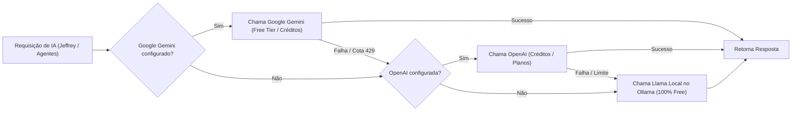

# Guia de Configuração dos Provedores de IA & Governança de Tokens

O **SpirandeliEmpire OS** possui um **AI Gateway Híbrido** com **Governança de Tokens e Delimitação Automática de Tarefas**, projetado para balancear velocidade, qualidade e proteção estrita do teto orçamentário de R$ 200/mês e da memória RAM (8GB) da VPS.

---

## 1. Como Funciona a Estratégia Híbrida (`AI_PROVIDER=hybrid`)

O sistema opera com um pipeline inteligente de 3 camadas:



1. **Google Gemini (Prioridade 1 — Gratuito):** Consome a cota gratuita do Google AI Studio (até 15 requisições/minuto e 1 milhão de tokens/minuto sem gastar R$ 1,00). Não consome CPU nem RAM da VPS!
2. **OpenAI (Prioridade 2 — Fallback de Créditos/Planos):** Se a cota do Gemini for atingida ou se desejar modelos GPT, aciona a OpenAI (usando créditos de boas-vindas ou modelo ultra-econômico `gpt-4o-mini`).
3. **Llama Local no Ollama (Prioridade 3 — Garantia Offline):** Se a internet oscilar ou as cotas de nuvem expirarem, o Llama roda diretamente no processador da sua VPS com custo zero permanente.

---

## 2. Passo a Passo: Configuração do Google Gemini (Créditos Gratuitos)

1. Acesse o **[Google AI Studio](https://aistudio.google.com/app/apikey)** e faça login com sua conta Google.
2. Clique no botão **"Create API key"** (Criar chave de API).
3. Selecione ou crie um projeto Google Cloud (o plano padrão gratuito não cobra nada).
4. Copie a chave gerada.
5. No arquivo `.env` da raiz do projeto, configure:

```env
GEMINI_API_KEY=AIzaSyD...sua_chave_aqui...
GEMINI_MODEL=gemini-1.5-flash
GEMINI_FREE_TIER_MODE=true
```

> **Dica:** O modelo `gemini-1.5-flash` é ultrarrápido, excelente em português brasileiro e possui a cota gratuita mais generosa.

---

## 3. Passo a Passo: Configuração da OpenAI (Créditos & Planos)

1. Acesse a **[OpenAI Platform](https://platform.openai.com/api-keys)**.
2. Faça login e acesse **Dashboard → API Keys**.
3. Clique em **"Create new secret key"**, dê um nome (ex: `spirandeli-empire`) e copie o token gerado (`sk-...`).
4. No arquivo `.env`, configure:

```env
OPENAI_API_KEY=sk-proj-...sua_chave_aqui...
OPENAI_MODEL=gpt-4o-mini
```

> **Dica:** O modelo `gpt-4o-mini` custa frações ínfimas de centavo de dólar por milhão de tokens, sendo ideal para negócios de alta escala.

---

## 4. Passo a Passo: Llama Local via Ollama (100% Local no VPS)

O container `empire_ollama` já vem provisionado no `docker-compose.yml`.

Para baixar o modelo Llama recomendado para VPS de 8GB de RAM:

```bash
# Baixar o modelo Llama 3.2 3B (leve, rápido e excelente para CPU)
docker exec -it empire_ollama ollama pull llama3.2:3b

# Ou Llama 3.2 1B (ultra-leve)
docker exec -it empire_ollama ollama pull llama3.2:1b

# Ou Llama 3.1 8B (para VPS com mais recursos ou GPU)
docker exec -it empire_ollama ollama pull llama3.1:8b
```

No `.env`:
```env
OLLAMA_BASE_URL=http://ollama:11434
LLAMA_MODEL=llama3.2:3b
```

---

## 5. Governança de Tokens e Delimitação Automática de Tarefas

O **TokenBudgetManagerService** inspeciona o prompt antes de qualquer disparo. Em português, o cálculo considera ~3.6 caracteres por token devido à morfologia e acentuação da língua.

### Matriz de Delimitação de Tarefas:

| Nível (Tier) | Faixa de Tokens | Exemplos de Tarefas | Motor Selecionado | Justificativa Arquitetural |
|---|---|---|---|---|
| **Tier 1: Micro** | `< 800 tokens` | Classificação de comentários, geração de títulos curtos, checagens de status, estruturação JSON | **Llama Local (Ollama)** | Poupa 100% das cotas das APIs em nuvem; resposta imediata sem tráfego de rede externo. |
| **Tier 2: Médio** | `800 a 3.500 tokens` | Roteiros de YouTube Dark (RISADA.exe), manuscritos curtos, e-mails de marketing | **Google Gemini Free Tier / OpenAI** | Aproveita os 15 RPM gratuitos do Google AI Studio com altíssima qualidade de escrita em PT-BR. |
| **Tier 3: Massivo** | `> 3.500 tokens` | Capítulos completos de livros KDP, transcrições longas, análise de documentos | **Google Gemini 1.5 Flash (1M tokens)** | **Protege a RAM da VPS (8GB):** O Llama local consumiria gigabytes de memória para janelas longas. O Gemini absorve até 1 milhão de tokens instantaneamente. |

### Configuração dos Limites no `.env`:

```env
# Ativa o roteamento prévio por tokens
TOKEN_ROUTING_ENABLED=true

# Limite máximo de tokens para tarefas que devem rodar no Llama local
TOKEN_THRESHOLD_LOCAL_MAX=800

# Limite a partir do qual tarefas são forçadas ao Gemini pela janela de 1M de tokens
TOKEN_THRESHOLD_LONG_CONTEXT=3500

# Teto diário de segurança de consumo de tokens em APIs
DAILY_API_TOKEN_CAP=500000
```

---

## 6. Como Testar e Monitorar

### Painel Web AI Engine (`/ai-engine`):
1. **Cards dos Provedores:** Status em tempo real de Google Gemini, OpenAI e Ollama com botões para testar conexão.
2. **Simulador de Tokens:** Permite colar qualquer texto ou usar presets ("Micro", "Roteiro Dark", "Capítulo KDP") para ver na hora a contagem de tokens, o Tier e o motor recomendado.
3. **Métricas de Economia:** Exibe quantos tokens foram processados de forma gratuita e o valor estimado economizado em Reais (R$).

### Chat do Jeffrey (`/jeffrey`):
- O cabeçalho permite alternar entre **Híbrido Inteligente**, **Google Gemini**, **OpenAI** ou **Llama Local**.
- Cada resposta do assistente exibe a etiqueta com o motor que respondeu, a latência em milissegundos e o total de tokens consumidos.
