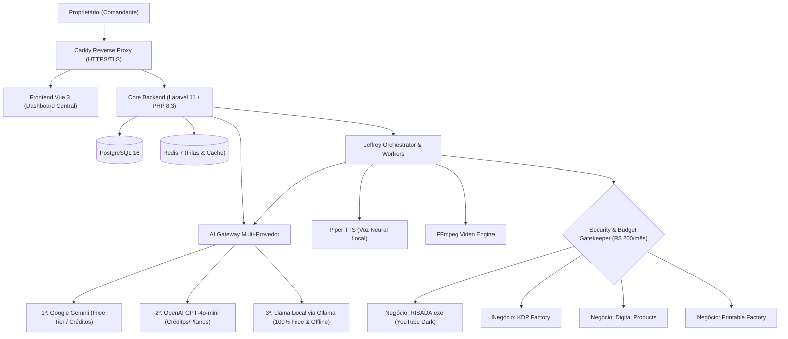

# SpirandeliEmpire OS — Arquitetura de Sistema v2.0

## 1. Visão Geral Arquitetural

O **SpirandeliEmpire OS** é concebido como um centro de comando unificado para múltiplos negócios digitais independentes. A plataforma opera sobre três premissas fundamentais:
1. **Núcleo Administrativo Central (Core):** Responsável por autenticação, governança financeira, dashboard unificada e monitoramento da infraestrutura.
2. **Agente Orquestrador Central (Jeffrey):** Assistente executivo de IA que coordena agentes especializados e planeja operações com suporte multi-provedor (Google Gemini, OpenAI e Llama Local).
3. **Múltiplos Negócios Independentes (Businesses):** Instâncias totalmente isoladas com volumes, configurações, orçamentos e logs próprios.

## 2. Princípios de Isolamento e Segurança
- **Independência de Falhas:** O encerramento, falha ou remoção de um negócio jamais afeta o Core ou os demais negócios.
- **Isolamento de Armazenamento:** Cada negócio grava exclusivamente em seu subdiretório `storage/businesses/<slug>`.
- **Governança Orçamentária:** Teto máximo de R$ 200,00 mensais com alerta automático aos 80% e bloqueio de novas despesas sem aprovação humana.
- **Gateway Híbrido de IA:** Prioriza cotas gratuitas do Google AI Studio (15 RPM a R$ 0,00) e créditos OpenAI; caso qualquer um atinja limites ou fique indisponível, aciona automaticamente o Llama local no Ollama sem interrupção de serviço.
